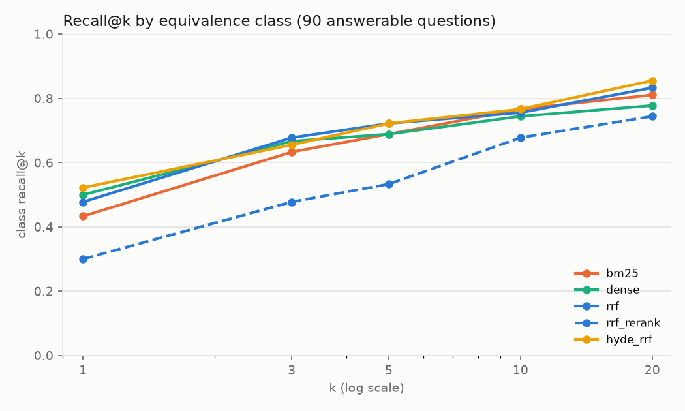
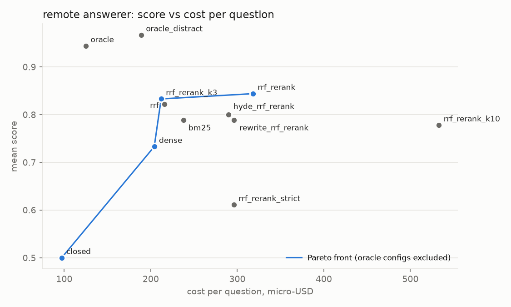
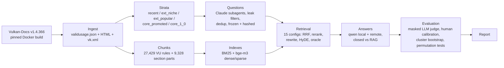

# Vulkan Valid Usage: does RAG over the spec beat model memory?

[](../../actions/workflows/ci.yml)


A controlled experiment on the 27,429 **Valid Usage (VU)** rules of the Vulkan specification
(`v1.4.366`): can a small local model with retrieval answer "is this API usage valid?" questions
better than models answering from memory? Does it make up fewer rules?

**Answer: yes, and by a lot.** With retrieval, `qwen3.5:9b` running locally on an 8 GB laptop GPU goes
from **0.28 to 0.70** (+0.42 [0.28, 0.56]). Without context, both models cite a VUID that does not
exist in **74-84%** of their answers.

➡ Full write-up: [`reports/report.md`](reports/report.md) ·
notebook: [`notebooks/report.ipynb`](notebooks/report.ipynb) ·
all tables: [`reports/report_tables.md`](reports/report_tables.md)

## Key findings

| answerer | closed-book | best RAG (`rrf_rerank`) | oracle (gold rule in context) |
|---|---|---|---|
| `qwen3.5:9b` (local, Ollama) | 0.28 [0.17, 0.40] | 0.70 [0.58, 0.81] | 0.96 |
| `deepseek-v4-flash` (remote) | 0.50 [0.36, 0.64] | 0.84 [0.76, 0.93] | 0.94 |

Score: correct 1 / partial 0.5 / incorrect 0, judged by an LLM judge calibrated against 80 human
labels (linear weighted kappa 0.89). 45 answerable questions over 40 API entities; 95% CIs are
cluster bootstrap by entity.

- **Retrieval is the bottleneck, not reading.** With the gold rule in context both models are almost
  always right (0.94-0.96), and four distractor rules barely change that. When retrieval puts the
  gold rule into the context, qwen scores 0.92. When it does not, qwen scores 0.42.
- **A local 9B model with RAG is not worse than the remote model from memory.** The non-inferiority
  test holds: +0.20 [0.02, 0.37] at a -0.05 margin.
- **The cross-encoder reranker hurts retrieval.** `bge-reranker-v2-m3` lowers class@5 from 0.72 to 0.53.
  It promotes long section chunks over the short rule chunks.
- **Hybrid BM25 + dense gives no clear gain at this size** (class@5 0.72 vs 0.69 / 0.69). The gain
  shows up only on descriptive questions that do not name API identifiers.
- **RAG doubles the cost per correct answer for a cheap remote model** (195 → 376 micro-USD). The
  remote model is cheap enough closed-book that ~1,900 extra input tokens are not paid back.
  A 3-chunk context keeps the score at 2/3 of the cost.

<p align="center">
  
  
</p>

> **Scope.** This is a pilot-sized study. The planned 400-rule main run was cancelled for budget
> reasons, so all hypothesis tests are exploratory: the results report effect sizes with CIs, and
> Holm-adjusted p-values are given for reference only. See
> [Limitations](reports/report.md#10-limitations).

## How it works



Design points:

- **One chunk per VU rule**, with a context header (entity, section). Rules with identical text
  that are shared by many commands (up to 40 draw/dispatch commands) are merged into
  **equivalence classes**. Retrieval metrics, context dedup and RRF all work per class.
- **Strata by expected memorization.** Rules that appeared after the models' training cutoff
  (2024-09-30, estimated with a probe of extension recognition) and niche extensions (< 50% device
  support on gpuinfo.org) are compared with core 1.0 rules.
- **Leak-controlled synthetic questions.** Each rule gets an identifier-style question and a
  descriptive question that does not name the API identifiers. An n-gram filter rejects questions
  that copy the rule text, bge-m3 near-duplicate detection removes repeats, and a second LLM pass
  marks other VUs that also answer a question as acceptable.
- **Honest evaluation.** The judge sees masked answers: context markers and VUIDs are removed.
  Fabricated VUIDs and identifiers are checked automatically against the registry. Unanswerable
  questions with a false premise are included, and the oracle and distractor controls separate
  retrieval errors from reading errors.
- **Reproducible.** The spec tag and Docker image digest are pinned, as are the model revisions and
  the Ollama digest. The question set and the sample are frozen with sha256 manifests. Every LLM
  call is cached by its input hash.

## Quick start

Requires Python 3.11 and [uv](https://docs.astral.sh/uv/).

```bash
uv sync --group dev
uv run pytest -q                 # 124 tests, no GPU or network needed
uv run vkrag report              # rebuilds reports/report_tables.md, report_data.json and figures
                                 # from the committed run in runs/pilot/
uv run --group report python notebooks/make_report_notebook.py   # re-executes notebooks/report.ipynb
```

## Full pipeline

The full run needs Docker (spec build), an NVIDIA GPU with ≥ 8 GB VRAM (bge-m3, reranker, qwen
through [Ollama](https://ollama.com)) and an [OpenRouter](https://openrouter.ai) key in `.env` (see
`.env.example`) for the remote answerer and the judge. The pilot cost $6.47 in total. The pipeline was
developed on Windows 11 + Docker Desktop (WSL2); in Git Bash set `MSYS_NO_PATHCONV=1` for docker commands.

```bash
uv sync --extra ml --group dev                     # torch (CUDA 12.4), FlagEmbedding, faiss
ollama create qwen3.5-9b-text -f configs/ollama/qwen3.5-9b-text.Modelfile   # see the file header

uv run vkrag spec build                            # Vulkan-Docs in the pinned Khronos image
uv run vkrag ingest && uv run vkrag chunk          # registry, VU conditions, chunks (~2.5 min)
uv run vkrag history && uv run vkrag strata       # uses the committed gpuinfo snapshot (see below)
uv run vkrag questions prepare --sample pilot      # then validate / review / freeze
uv run vkrag index                                 # BM25 + bge-m3 (~4 min)
uv run vkrag transform --run-id pilot              # qwen query rewrite + HyDE
uv run vkrag retrieve --run-id pilot --configs all
uv run vkrag acceptable --run-id pilot
uv run vkrag generate --help                       # answers (local + remote)
uv run vkrag judge --help                          # LLM judge
uv run vkrag hypotheses && uv run vkrag report
```

`uv run vkrag --help` lists all commands. The large derived files (`chunks.jsonl`, indexes, the
built spec) are not committed and are rebuilt by the commands above.

The extension popularity data is committed as `data/external/gpuinfo_snapshot.json` (2026-11-07).
gpuinfo.org has no API. To make a new snapshot, save the pages
`https://vulkan.gpuinfo.org/listextensions.php?platform=<os>` and `listinstanceextensions.php?platform=<os>`
(age filter "Recent (1y)") as `data/external/gpuinfo/<os>.html` and `<os>_instance.html` for
`windows` and `linux`, then run `uv run vkrag gpuinfo`.

## Repository layout

```
src/vkrag/
  ingest/        spec build, validusage.json + adoc conditions, vk.xml registry, gpuinfo, SPIR-V names
  chunking.py    VU and section chunks; equivalence.py: classes of identical rules
  strata.py      stratified sample; history.py: VUID history over 97 spec tags
  questions/     batch preparation, validation (leaks, dedup), review, freeze, acceptable VUIDs
  index/         BM25 tokenizer for Vulkan identifiers, bge-m3 dense/sparse indexes
  retrieval/     BM25 / dense / sparse / RRF / reranker / rewrite / HyDE / oracle configs
  generation/    Ollama and OpenRouter clients, answer prompts
  eval/          masking, auto-checks, LLM judge, human calibration, hypothesis tests, power
  report.py      tables, figures, error candidates
configs/         default.yaml (pinned versions, seeds, thresholds), Ollama Modelfile
data/            frozen questions + generation logs, processed registry/strata, external snapshots
runs/pilot/      the final run: retrieved contexts, answers, judgments, scores, human labels
reports/         report.md (write-up), report_tables.md, figures, data facts
```

## Notes

- Questions were generated with Claude (one Claude Code subagent per batch). Prompts and
  input/output hashes are in `data/questions/generation_log/`. Claude models were not used as
  answerers or as the judge.
- Code comments refer to sections of the internal design document as `PLAN §N`. That document is
  not published. The decisions that matter for the results are described in `reports/report.md`.

## License

Code: [MIT](LICENSE). Third-party data included in this repository keeps its own license:

- Text derived from the [Vulkan specification](https://github.com/KhronosGroup/Vulkan-Docs)
  (VU rules, registry data in `data/` and `runs/`): © The Khronos Group Inc., Apache-2.0 / CC-BY-4.0,
  see the Vulkan-Docs `LICENSE` files.
- SPIR-V / GLSL identifiers from [SPIRV-Headers](https://github.com/KhronosGroup/SPIRV-Headers)
  (MIT-style Khronos license) and GLSL.
- Extension support statistics from [vulkan.gpuinfo.org](https://vulkan.gpuinfo.org) by Sascha Willems.
