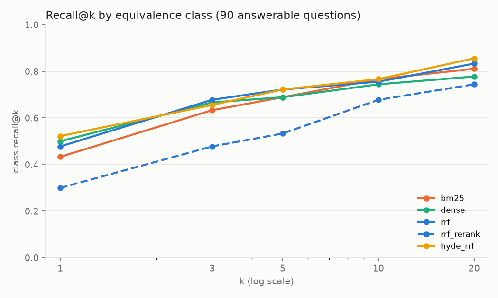
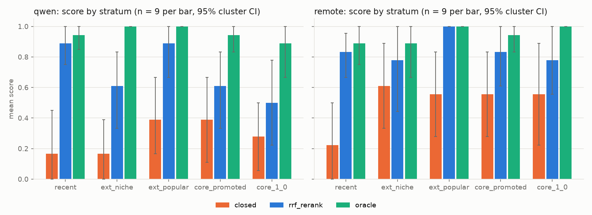
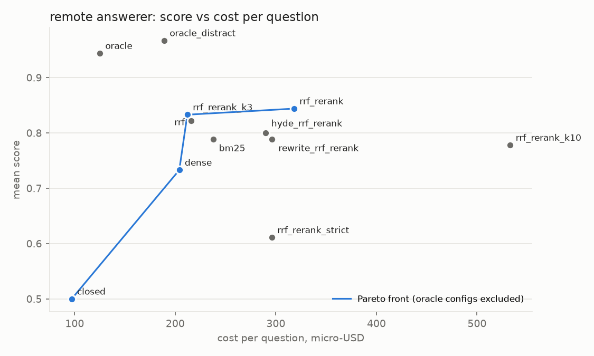
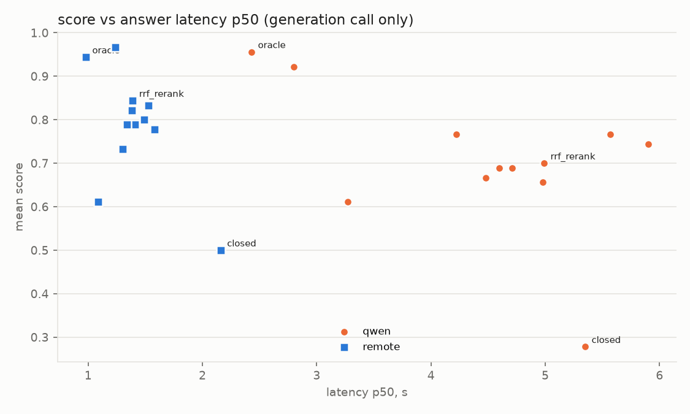

# Vulkan Valid Usage: does RAG over the specification beat model memory?

Final report, 2026-11-11. Run `runs/pilot` (spec `v1.4.366`). Every table here comes from
`uv run vkrag report` (full tables in `reports/report_tables.md`, numbers in `reports/report_data.json`);
figures are in `reports/figures/` and `notebooks/report.ipynb`.

**Status of the evidence.** The planned main run (400 VUs, ~7,900 answers) was cancelled because of the
budget (the extrapolated cost was ~$45; ~$4 was left). The pilot is therefore the final run. Its 45
answerable questions were also used to tune the masking, the automatic checks and the judge rubric.
**All hypothesis tests are exploratory:** we report effect sizes with cluster-bootstrap CIs and
permutation p-values. Holm-adjusted p-values over the pre-registered 8-test family are given for
reference only (PLAN §10, 2026-11-10).

## 1. Summary

- **RAG clearly beats closed-book on Valid Usage questions.** The local `qwen3.5:9b` rises from
  0.28 to 0.70 (`rrf_rerank`, +0.42 [0.28, 0.56]). The remote `deepseek-v4-flash` rises from 0.50 to
  0.84 (+0.34 [0.20, 0.48]). Without context, both models make up VUIDs: 74% (qwen) and 84% (remote)
  of closed-book answers cite a VUID that does not exist.
- **With the right rule in context, both models are almost always right.** The oracle scores 0.96 and
  0.94, and four distractor VUs barely change that (0.92 / 0.97). Most remaining errors are
  **retrieval errors**: with `rrf_rerank` the gold rule reaches the 5-chunk context for 25 of 45
  questions. Then qwen scores 0.92; otherwise it scores 0.42.
- **The 9B local model with RAG is not worse than the remote model from memory** (H4 non-inferiority
  holds: +0.20 [0.02, 0.37], margin -0.05). The claim holds only for this remote model.
- **Hybrid retrieval gives no measurable gain over BM25 or dense alone** at this size (class@5 0.72 vs
  0.69 / 0.69). The gain is concentrated on descriptive questions (interaction +0.11 [0.00, 0.22]).
- **The cross-encoder reranker hurts retrieval** (class@5 0.72 → 0.53, -0.19 [-0.29, -0.09]): it
  promotes long section chunks over the short VU chunks. It does not change answer quality,
  because the models answer partly from the sections and from memory.
- **RAG raises the remote cost per correct answer** (195 → 376 micro-USD). The remote model is so
  cheap closed-book that the accuracy gain does not pay for ~1,900 extra input tokens. H5 is not
  supported in the predicted direction. A 3-chunk context (`rrf_rerank_k3`) keeps the score (0.83) at
  2/3 of the cost.

## 2. Setup

| component | choice |
|---|---|
| Corpus | Vulkan-Docs `v1.4.366`, built in the pinned Khronos Docker image; single-page HTML + `validusage.json` (schema v2) |
| Chunks | one chunk per VU rule (27,429) with a context header; section parts without VU blocks (4,027 refpage + 5,301 prose, ≤ 797 tokens) |
| Equivalence classes | VUID suffix + identical normalized raw text; retrieval metrics and context dedup are per class |
| Questions | Claude (`claude-opus-5-5`, one Claude Code subagent per batch); 45 VUs × 2 styles (identifier / descriptive) = 90 answerable + 5 unanswerable; each VU enters generation in one style |
| Retrieval | BM25 (own tokenizer: identifiers whole + parts, Snowball), `bge-m3` dense and sparse, RRF (k=60, depth 50 distinct classes), `bge-reranker-v2-m3` (max_length 1024); qwen query rewrite and HyDE |
| Answerers | `qwen3.5-9b-text` on Ollama (RTX 3070 Laptop, temperature 0, thinking off, num_ctx 8192); `deepseek/deepseek-v4-flash-0731` via OpenRouter, provider `cohere/fp8`, reasoning off |
| Context | k = 5 chunks after class dedup (controls k = 3, 10); prompt allows own knowledge if the model says so (`rrf_rerank_strict`: context only) |
| Judge | `google/gemini-3.8-flash` (Google AI Studio, reasoning medium); correctness without context against reference + gold VU text, separate faithfulness call for RAG answers; answers masked (context markers, VUIDs) |
| Statistics | paired by question, clustered by entity (40 entities); cluster bootstrap 95% CI (10k), cluster sign-flip permutation p (10k) |

Strata (PLAN §4, Stage 2), 9 VUs each: `recent` (first appeared after the 2024-09-30 cutoff assumed for
both models), `ext_niche` (extensions with < 50% device support in the gpuinfo snapshot), `ext_popular`,
`core_promoted` (core since 1.1-1.4), `core_1_0`.

## 3. Corpus and sample (Table 0)

| item | value |
|---|---|
| VUs (explicit / total) | 20,575 / 27,429; 100% of explicit VUIDs mapped to a section; 0 differences with Vulkan-Headers |
| Chunks VU / refpage / prose | 27,429 / 4,027 / 5,301; tokens p50 98 / 400 / 127 |
| Explicit equivalence classes | 7,261 (5,565 singletons, largest 40: draw/dispatch rules shared by ~40 commands) |
| Eligible VUs per stratum | recent 5,184 · ext_niche 7,907 · ext_popular 2,484 · core_promoted 2,264 · core_1_0 1,633 |
| Questions | 90 answerable (45 identifier / 45 descriptive; rule / scenario / yes_no 30 / 30 / 30) + 5 unanswerable |
| `descriptive_infeasible` | 0 |
| Questions with extended `acceptable_vuids` | 0 (Stage 3b judge: 0 of 900 candidates equivalent) |
| Gold class size | 1 VU: 26 questions; 2-4: 22; 11-17: 16; 26: 18; 39: 8 |

Large gold classes (26 questions with ≥ 26 members) make class@1 easier: any of up to 39 draw
commands with the identical rule counts as a hit. Strict recall (the gold entity itself) is reported
next to it.

## 4. Retrieval (Table 1)

90 answerable questions; metrics on the ranking before the context is assembled.

| config | strict@5 | class@1 | class@5 [95% CI] | class@20 | MRR@10 | nDCG@10 | class@5 identifier / descriptive | VU share of context |
|---|---|---|---|---|---|---|---|---|
| bm25 | 0.59 | 0.43 | 0.69 [0.58, 0.79] | 0.81 | 0.55 | 0.47 | 0.84 / 0.53 | 60% |
| dense | 0.38 | 0.50 | 0.69 [0.57, 0.80] | 0.78 | 0.59 | 0.40 | 0.84 / 0.53 | 76% |
| sparse | 0.19 | 0.20 | 0.31 [0.23, 0.40] | 0.47 | 0.25 | 0.22 | 0.56 / 0.07 | 25% |
| **rrf** | 0.54 | 0.48 | **0.72** [0.60, 0.83] | 0.83 | 0.59 | 0.46 | 0.82 / 0.62 | 71% |
| rrf_sparse | 0.47 | 0.38 | 0.60 [0.49, 0.71] | 0.80 | 0.47 | 0.40 | 0.80 / 0.40 | 55% |
| rrf_rerank | 0.41 | 0.30 | 0.53 [0.42, 0.64] | 0.74 | 0.41 | 0.37 | 0.71 / 0.36 | 42% |
| bm25_rerank / dense_rerank | 0.46 / 0.33 | 0.31 / 0.29 | 0.52 / 0.54 | 0.74 / 0.80 | 0.41 / 0.40 | 0.38 / 0.33 | | 40% / 51% |
| rewrite_rrf | 0.47 | 0.39 | 0.67 [0.56, 0.77] | 0.81 | 0.52 | 0.41 | 0.80 / 0.53 | 81% |
| hyde_rrf | 0.53 | **0.52** | **0.72** [0.60, 0.83] | **0.86** | **0.61** | 0.48 | 0.82 / 0.62 | 68% |
| rewrite / hyde_rrf_rerank | 0.41 / 0.44 | 0.31 / 0.29 | 0.58 / 0.54 | 0.76 / 0.77 | 0.42 / 0.41 | 0.36 / 0.38 | | 45% / 41% |
| oracle | 1.00 | 1.00 | 1.00 | 1.00 | 1.00 | 0.88 | | 50% |



- **Identifier vs descriptive.** Every retriever finds identifier questions much better (class@5 0.84
  vs 0.53 for BM25 and dense). RRF closes part of the gap on descriptive questions (0.62). On the 45
  VU pairs, the RRF-over-BM25 gain is larger for descriptive questions: +0.11 [0.00, 0.22].
- **Reranker.** Every `*_rerank` variant loses 9-19 points of class@5 against its input, and the
  VU share of the context falls from 71% to 42%. `bge-reranker-v2-m3` prefers long section chunks
  that discuss the question topic over the one-sentence VU rule. We kept this result rather than
  tuning around it (user decision 2026-11-08). We did not test a VU-only rerank or score
  normalization by length.
- **Query transformations.** HyDE (qwen hypothetical answer into the dense leg) matches RRF on
  class@5 and is best at k = 1 and k = 20. Rewriting *replaces* the question and loses 5 points.
  qwen invented a non-existent Vulkan identifier in 16% of rewrites and 22% of HyDE passages
  (Section 8, D).
- **Sparse bge-m3 weights** are weak alone (0.31) and pull the RRF fusion down (0.60).

## 5. Answer quality (Table 2)

Answerable questions in generation, n = 45 per cell (40 entities). Score: correct 1, partial 0.5,
incorrect 0. Halluc. = the judge found a statement that contradicts the rule or the reference.
Fabr. VUID = a cited VUID that does not exist in `v1.4.366`.

| config | qwen score [95% CI] | remote score [95% CI] | qwen / remote halluc. | qwen / remote fabr. VUID | citation acc. qwen / remote | faithful qwen / remote |
|---|---|---|---|---|---|---|
| closed | 0.28 [0.17, 0.40] | 0.50 [0.36, 0.64] | 0.73 / 0.51 | 0.74 / 0.84 | 0.00 / 0.05 | - |
| bm25 | 0.69 [0.57, 0.80] | 0.79 [0.69, 0.89] | 0.36 / 0.18 | 0.09 / 0.09 | 0.77 / 0.73 | 0.51 / 0.64 |
| dense | 0.77 [0.64, 0.88] | 0.73 [0.61, 0.85] | 0.27 / 0.22 | 0.11 / 0.11 | 0.73 / 0.69 | 0.49 / 0.44 |
| rrf | 0.77 [0.66, 0.87] | 0.82 [0.73, 0.91] | 0.27 / 0.11 | 0.07 / 0.09 | 0.63 / 0.64 | 0.49 / 0.58 |
| rrf_rerank | 0.70 [0.58, 0.81] | 0.84 [0.76, 0.93] | 0.40 / 0.16 | 0.22 / 0.16 | 0.60 / 0.60 | 0.47 / 0.53 |
| rewrite_rrf_rerank | 0.69 [0.57, 0.81] | 0.79 [0.69, 0.88] | 0.31 / 0.16 | 0.11 / 0.11 | 0.70 / 0.66 | 0.52 / 0.62 |
| hyde_rrf_rerank | 0.67 [0.55, 0.77] | 0.80 [0.69, 0.90] | 0.38 / 0.18 | 0.18 / 0.13 | 0.63 / 0.65 | 0.53 / 0.58 |
| oracle | 0.96 [0.90, 1.00] | 0.94 [0.89, 0.99] | 0.07 / 0.02 | 0.00 / 0.00 | 1.00 / 1.00 | 0.91 / 0.96 |
| oracle_distract | 0.92 [0.85, 0.98] | 0.97 [0.92, 1.00] | 0.11 / 0.02 | 0.00 / 0.00 | 1.00 / 1.00 | 0.87 / 0.96 |
| rrf_rerank_strict | 0.61 [0.49, 0.73] | 0.61 [0.48, 0.73] | 0.40 / 0.13 | 0.07 / 0.07 | 0.74 / 0.61 | 0.47 / 0.44 |
| rrf_rerank_k3 | 0.66 [0.52, 0.78] | 0.83 [0.73, 0.92] | 0.40 / 0.16 | 0.18 / 0.20 | 0.59 / 0.50 | 0.48 / 0.44 |
| rrf_rerank_k10 | 0.74 [0.62, 0.85] | 0.78 [0.68, 0.88] | 0.31 / 0.20 | 0.11 / 0.04 | 0.71 / 0.76 | 0.51 / 0.53 |

Further columns (correct share, selective accuracy, abstention, fabricated identifiers, yes/no
verdict accuracy, self-knowledge, missing) are in `report_tables.md`. Notes:

- **Abstention is rare.** Abstention is 0-2% except `rrf_rerank_strict` (qwen 13%, remote 20%).
  Selective accuracy there is 0.70 / 0.76, so the strict prompt mostly turns answers that
  would have been partly right into "I don't know". It costs 0.09 (qwen) and 0.23 (remote) of score.
- **Missing answers.** 5 of 1,180 answers are missing (truncated at 4,096 tokens or empty): qwen
  closed 2, qwen `rewrite_rrf_rerank` 1, qwen `rrf_rerank_k3` 1, remote closed 1. They are scored as
  incorrect. With `think=false`, qwen still "reasons" inside the answer and sometimes does not stop.
- **Faithfulness is low even when answers are right** (≈ 0.5 supported). In 29-47% of RAG answers the
  models used their own knowledge (`self_knowledge`), which the prompt allows if stated. Answers that
  are only partly supported by the context are common because the context often holds a neighbouring
  rule rather than the gold one.
- **Trivial baseline.** On the 15 yes/no questions the majority verdict gives 0.53 ("always no"
  0.47). Closed-book verdict accuracy is 0.60 (qwen) and 0.67 (remote); RAG gives 0.67-0.93 (0.80 or
  more in all but qwen `bm25`).
- **Gold in context vs not** (`rrf_rerank`): qwen 0.92 [0.82, 1.00] when the gold class reached the
  context (25 questions) vs 0.42 [0.25, 0.60] when it did not (20). Remote: 0.94 vs **0.72**. The
  remote model recovers much more from memory and from neighbouring rules when retrieval misses.
  This is why the reranker's retrieval loss does not show up in its score (H3b).

### By stratum (H1)



| answerer | config | recent | ext_niche | ext_popular | core_promoted | core_1_0 |
|---|---|---|---|---|---|---|
| qwen | closed | 0.17 | 0.17 | 0.39 | 0.39 | 0.28 |
| qwen | rrf_rerank | 0.89 | 0.61 | 0.89 | 0.61 | 0.50 |
| qwen | oracle | 0.94 | 1.00 | 1.00 | 0.94 | 0.89 |
| remote | closed | **0.22** | 0.61 | 0.56 | 0.56 | 0.56 |
| remote | rrf_rerank | 0.83 | 0.78 | 1.00 | 0.83 | 0.78 |
| remote | oracle | 0.89 | 0.89 | 1.00 | 0.94 | 1.00 |

n = 9 per cell; the 95% CIs are 0.4-0.6 wide (`report_tables.md`). Closed-book is lowest on `recent`
for both models, consistent with the assumed cutoff. The remote model's closed-book score is flat at
~0.56-0.61 on all older strata. qwen closed-book is low everywhere. The planned difference-in-differences
(RAG gain on `recent`+`ext_niche` vs `core_1_0`) points the predicted way but is not resolved: qwen +0.36
[-0.09, 0.80], remote +0.17 [-0.21, 0.50].

### Unanswerable questions (false premise)

5 questions per cell (invented commands or rules). Premise rejected / accepted:

| config | qwen | remote |
|---|---|---|
| closed | 1 / 4 | **0 / 5** |
| bm25 | 3 / 2 | 3 / 2 |
| dense | 2 / 2 | 2 / 3 |
| rrf | 2 / 3 | 1 / 2 |
| rrf_rerank | 2 / 2 | 1 / 3 |
| hyde_rrf_rerank | 3 / 2 | 3 / 2 |
| rrf_rerank_strict | 2 / 3 | **4 / 1** |

From memory, both models accept almost every false premise; the remote model accepts all five and
describes the invented command. RAG does **not** increase agreement with a false premise. If anything
it reduces it, because the context shows the real API surface. The strict prompt helps the remote
model most (4 of 5 rejected). With n = 5 these are anecdotes, not estimates.

## 6. Hypotheses (Table 3, exploratory)

| test | comparison | A → B | diff [95% CI] | p | p_Holm | reading |
|---|---|---|---|---|---|---|
| H1a | qwen `rrf_rerank` vs `closed` (score) | 0.278 → 0.700 | +0.422 [0.277, 0.558] | 0.0001 | 0.0008 | RAG better |
| H1b | remote `rrf_rerank` vs `closed` (score) | 0.500 → 0.844 | +0.344 [0.198, 0.479] | 0.0003 | 0.0021 | RAG better |
| H2a | `rrf` vs `bm25` (class@5) | 0.689 → 0.722 | +0.033 [-0.023, 0.089] | 0.45 | 1.0 | no difference detected |
| H2b | `rrf` vs `dense` (class@5) | 0.689 → 0.722 | +0.033 [-0.011, 0.081] | 0.38 | 1.0 | no difference detected |
| H3a | `rrf_rerank` vs `rrf` (class@5) | 0.722 → 0.533 | -0.189 [-0.290, -0.087] | 0.001 | 0.007 | opposite: reranker hurts |
| H3b | `rrf_rerank` vs `rrf` (score, both answerers) | 0.794 → 0.772 | -0.022 [-0.128, 0.080] | 0.76 | 1.0 | no difference; latency not measured |
| H4 | qwen `rrf_rerank` − remote `closed`, NI margin -0.05 | 0.500 vs 0.700 | +0.200 [0.023, 0.372] | NI 0.003 | 0.013 | non-inferior (also higher) |
| H5 | remote cost per correct, `rrf_rerank` vs `closed` | 195 → 376 µ$ | +181 µ$ [57, 276] | 0.001 | 0.007 | opposite: RAG costs more per correct answer |

- **H1** (RAG better than closed-book): supported for both answerers, with large effects. The
  stratum part ("largest on recent and niche rules") points the predicted way but is not resolved.
- **H2** (hybrid better than either retriever): not supported at this size. The MDE at the pilot size
  is 0.13 (α 0.05) and the observed gain is 0.03. Exploratory support for the mechanism: the hybrid
  helps descriptive questions.
- **H3** (reranker improves recall and accuracy): contradicted for recall; no effect on accuracy.
  The latency condition could not be checked (no phase L).
- **H4** (local 9B + RAG not worse than remote closed-book): holds, and the point estimate is +0.20.
- **H5** (RAG raises cost per question but lowers cost per correct answer): the first half holds
  (+220 µ$ [175, 260] per question). The second is contradicted: the remote closed-book answer costs
  97 µ$ and is right half the time (195 µ$ per correct answer). At 318 µ$ per question, `rrf_rerank`
  would cost more per correct answer even with a perfect score; so would `rrf_rerank_k3` (212 µ$).
  Only a short, precise context can win here: the oracle costs 125 µ$ per question and 133 µ$ per
  correct answer.
- **Sensitivity (correct = 1, partial = 0):** H1a +0.42 (p 0.0003), H1b +0.36 (p 0.001), H3b -0.03,
  H4 +0.18 [-0.02, 0.37] (NI still holds).
- **Minimum detectable effects at the pilot size** (binary, power 0.8, α 0.05 / α 0.05/8): H1a 0.35 /
  0.44, H1b 0.30 / 0.37, H2 0.13 / 0.18, H3 0.20 / 0.25. Only effects of H1 size can be resolved; a
  null result for H2/H3b means "smaller than ~0.15-0.2", not "zero".
- **Retrieval loss** (`oracle` − `rrf_rerank`): qwen +0.26 [0.16, 0.37], remote +0.10 [0.00, 0.20].

## 7. Cost and latency (Table 4)

Remote answerer, answerable questions (µ$ = micro-USD; reasoning is off, so no reasoning tokens):

| config | score | cost / question, µ$ | cost / correct, µ$ | tokens in | tokens out | score gain per $ vs closed |
|---|---|---|---|---|---|---|
| closed | 0.50 | 97 | 195 | 114 | 291 | - |
| bm25 | 0.79 | 238 | 301 | 1,373 | 163 | 2,050 |
| dense | 0.73 | 204 | 278 | 1,125 | 167 | 2,178 |
| rrf | 0.82 | 216 | 263 | 1,220 | 165 | 2,706 |
| rrf_rerank | 0.84 | 318 | 376 | 1,953 | 158 | 1,557 |
| rrf_rerank_k3 | 0.83 | 212 | 254 | 1,209 | 171 | 2,896 |
| rrf_rerank_k10 | 0.78 | 533 | 685 | 3,506 | 167 | 638 |
| oracle | 0.94 | 125 | 133 | 680 | 107 | 15,857 |



Closed-book answers are the longest (291 output tokens vs ~160). Without a rule to quote, the
model writes longer and partly invented explanations. The Pareto front of deployable configurations
is `closed` → `dense` → `rrf_rerank_k3` → `rrf_rerank`. A context of 10 chunks costs 1.7× more than
5 and is not better.

**Latency.** Phase L (a controlled latency run with all models loaded) was dropped (PLAN §10). The
only latencies we have are those of the generation call during the batch run. They exclude retrieval
and rerank time, and qwen ran sequentially on a shared laptop GPU. p50 / p95 in seconds: qwen
closed 5.4 / 23.9, `rrf_rerank` 5.0 / 12.5, oracle 2.4 / 6.1; remote closed 2.2 / 4.6,
`rrf_rerank` 1.4 / 4.0. Closed-book is not faster, because its answers are longer.



**Experiment spend (OpenRouter), USD:**

| item | USD |
|---|---|
| answerer_remote (all phase C calls incl. retries) | 0.148 |
| judge: correctness + faithfulness (2,273 calls incl. re-judging) | 5.105 |
| `acceptable_vuids` check, Stage 3b (900 calls) | 0.926 |
| cutoff probe, Stage 2 | 0.290 |
| logged in run files | 6.469 |
| key usage (incl. connectivity checks, provider probe, stopped runs) | ≈ 7.06 |

The judge is 79% of the logged spend. The system itself (the remote answerer) cost $0.15 for 590 answers.

## 8. Error analysis

Automatic selection by category (`reports/error_candidates.md`, regenerated by `vkrag report`), then a
manual reading. Counts are answer-level (question × answerer); the categories overlap.

**A. Retrieval missed the rule (`rrf_rerank`: gold class not in the context for 20 of 45 questions; 23
non-correct answers).**
1. `qp-2445ff385a-de` (ext_niche, yes/no: must H.264 `idrPeriod` be ≥ `gopFrameCount`?). The context
   held the parameter definitions but not the VU. Both models answered "No" and argued from the
   *absence* of a rule ("the spec does not impose any relationship"). For yes/no questions a missing
   rule turns into a confident wrong "no".
2. `qp-14be9f7fd8-de` (dynamic vertex stride before `vkCmdDrawIndirectCount`). The context had the
   parameter sections of five other indirect draw commands. qwen named `vkCmdSetVertexInputEXT`
   (score 0). The remote model fell back on memory and named `vkCmdBindVertexBuffers2`, but missed
   the non-NULL `pStrides` (0.5).
3. `qp-1bdef10841-id` (atomics on a storage texel buffer without the atomic format feature). The
   reranker put the prose section on storage texel buffers first. qwen quoted it, reasoned about
   `fragmentStoresAndAtomics` and concluded that "nothing is wrong" (0).
4. `qp-21904f21bf-id` (depth aspect on a color image). qwen found the right violation from general
   knowledge but added a non-existent `VK_IMAGE_ASPECT_R_BIT` and a false claim that depth cannot be
   copied to a buffer (partial, hallucination).
5. `qp-47e8a572a9-de` (destroying a buffer still used by submitted work). The right verdict is reached
   through the host-synchronization section instead of the VU, with a false statement that
   `vkDestroyBuffer` has no such VU (partial).

**B. The rule was in the context, the answer was still wrong (5 of 50 in-context `rrf_rerank` answers).**
6. `qp-447f14a302-id` (block-compressed `vkCmdCopyImage`: a region that "ends above the bottom edge").
   qwen answered "No" with both `rrf_rerank` and the oracle context. It read "does not equal the
   height" in the VU as "extends beyond" and reversed the condition. The remote model was right.
7. `qp-7979434efb-id` (shader objects, `taskShader` enabled, task stage never bound). Both models
   quoted the right VUID (`…-None-08693`) but misread its multi-clause condition. The remote model
   claimed that binding `VK_NULL_HANDLE` to the mesh stage is the error (0). qwen found the missing
   task bind but demanded a non-null task shader (0.5).
8. `qp-747b319746-de` (`legacyVertexAttributes`: must a 3×32-bit attribute address be
   component-aligned?). qwen gave the right "No" and then invented a stricter alignment rule (0.5).
9. `qp-3018db2308-de` (`VK_IMG_filter_cubic` only; which view types are forbidden). With the oracle
   context the remote model read "If the VK_EXT_filter_cubic extension is not enabled" as a condition
   that does **not** apply to it and allowed every view type (0). This is a negation error on exactly
   the gold rule.

**C. Closed-book: the model does not know the rule (closed score 0 where the oracle scores 1, on
`recent` / `ext_niche`: 20 answers).**

10. `qp-372fd8f17a-id` (recent: `VkPhysicalDeviceCopyMemoryIndirectPropertiesKHR::supportedQueues`).
    qwen invented `maxCommandBufferLevels` and a non-existent `VK_COMMAND_POOL_CREATE_HOST_COHERENT_BIT`.
    The remote model corrected itself three times in one answer ("No—that's not the relevant limit…
    Actually … `earlyFragmentTestSamples`? No.") and never reached the property.
11. `qp-4726e63aac-de` (recent: fragment-region rendering requires `minSampleShading` = 0). Both models
    answered the correct "not valid", but for invented reasons: a `VK_DYNAMIC_RENDERING_FRAGMENT_REGION_BIT`
    flag (qwen), a fabricated quote of `VUID-vkCmdDraw-None-08607` (remote). Score 0. A right verdict
    from memory is often a coin flip with a made-up justification. This is why closed-book verdict
    accuracy (0.60-0.67) is much higher than closed-book score.
12. `qp-490a161efb-de` (ext_niche: `TaskCountNV` storage class). qwen gave the right "No" but described
    an invented read-only input `num_mesh_groups` (0).
13. `qp-3018db2308-de` (ext_niche, cubic filtering). qwen closed-book listed made-up extensions
    (`VK_EXT_color_buffer_nonlinear`) and an unrelated image-creation flag.
14. No answer was flagged `outdated_identifier` (an identifier that exists only in older spec tags),
    and none of the 45 generation VUs changed text within the last 10 tags. The PLAN category
    "answered by an old version of the spec" has no detected cases on this sample.

**D. Query transformation invented an identifier and broke retrieval (5 questions where class@5
dropped from 1 to 0 against `rrf`).**

15. `qp-372fd8f17a-id`: the rewrite fell into a repetition loop
    (`VkCommandPoolCreateFlags, VkCommandPoolCreateFlagsKHR, VkCommandPoolCreateFlags, …` until
    `num_predict`), with an invented `…KHR` alias.
16. `qp-7219f374f5-id`: the whole question was rewritten into a single invented extension name
    `VK_EXT_line_stippling`. A rewrite that *replaces* the query loses all of the question when it
    goes wrong.
17. `qp-09e74c06cd-de` → `vkGetDeviceQueueFamilyProperties, VK_QUEUE_TRANSFER_BIT`;
    `qp-824c087d23-de` → `vkCmdCopyImageToImageBlockAlignment`. Both are plausible-looking names that
    do not exist.
18. `qp-7979434efb-id` (HyDE): the hypothetical answer argued from an invented
    `VK_PIPELINE_CREATE_NO_PIPELINE_LAYOUT_BIT` and pulled the dense leg away from shader-object rules.

**E. Question, reference or judge issues (13 flagged answers).**

19. `qp-9b90a92152-id`: the judge flagged a "second violation" in two answers (`objectType =
    VK_OBJECT_TYPE_BUFFER` with `objectHandle = VK_NULL_HANDLE`). We checked: under
    `VUID-VkDebugUtilsObjectNameInfoEXT-objectType-02590` a null handle is allowed there. The question
    is sound and the partial score correctly penalizes a false claim.
20. `qp-56d6a4aeb3-de` (multiview framebuffer): qwen with the oracle stated the right rule ("layerCount
    must be ≥ 3") but applied it to the framebuffer layers instead of the attachment view (0.5).
    This is a model error, not a question defect.
21. **Bare verdicts.** The remote model sometimes answers only "Yes." or "No.". The judge scores a bare
    correct verdict as `partial` (no justification). This affected 20 answers (11 remote cells),
    and none of them was in the 80 calibration items, so the human never ruled on this case. If they
    count as correct, remote scores rise by 0.01-0.07 (`rrf_rerank` 0.844 → 0.856, oracle 0.944 →
    0.978, `rrf_rerank_strict` 0.611 → 0.678). Remote closed-book has no bare answers, so H1b grows
    slightly (+0.356) and H4 does not change. qwen never answers this way.
22. No question was found defective on review: all 13 flagged cases are model or rubric effects as
    above. The question review (user, 2026-11-08) rejected one near-verbatim question before freezing.

## 9. Judge calibration

One annotator (the author) labelled 80 answers. They were stratified by answerer × configuration and
balanced over stratum and answer type, blind to model, configuration and judge output: 40 for tuning
and 40 held-out. The rubric was not changed after tuning.

| set | n | correctness (linear weighted κ) | hallucination κ | abstained κ |
|---|---|---|---|---|
| tune | 40 | 0.881 [0.699, 1.000] | 0.867 [0.652, 1.000] | 1.000 |
| **held-out, blind first pass** | 40 | **0.825 [0.634, 0.957]** | **0.658 [0.342, 0.908]** | - (no human abstention; agreement 1.0) |
| held-out, revised | 40 | 0.897 [0.755, 1.000] | 0.749 [0.478, 0.944] | - |
| all 80, revised | 80 | 0.890 [0.785, 0.965] | 0.806 [0.641, 0.937] | 1.000 |

The held-out set stopped being fully blind when the annotator revised five labels on three items
after seeing the list of disagreements. Two items moved towards the judge, one away from it. The blind
first pass is therefore the primary held-out estimate. Correctness passes the κ ≥ 0.6 target clearly.
Hallucination passes on the point estimate, but its CI reaches 0.34; it should be read as a rough signal.
Mean score: human 0.762 vs judge 0.775 over the 80 items. On the tuning set the judge was slightly more
lenient (all three disagreements were human `partial` vs judge `correct`); on the held-out set it was
slightly stricter.

**Length.** The judge score falls with answer length in 16 of 24 (answerer × configuration) cells with
|ρ| > 0.3, 14 of them negatively. The human labels show the same trend (ρ(length, human) -0.61,
ρ(length, judge) -0.56), and the judge-human difference does not depend on length (ρ 0.13). Long
answers are worse answers here (hedging, invented detail); we see no length bias of the judge.

## 10. Limitations

- **Exploratory, small sample.** 45 answerable questions in generation (40 entities), 9 per stratum,
  5 unanswerable. Only H1-sized effects (≥ 0.3) are resolvable; the stratum analysis and the
  unanswerable results are descriptive. No repeated runs: the variance across runs is unknown.
  qwen on Ollama is not fully deterministic at temperature 0 (a re-run of a truncated answer
  finished differently), and remote providers do not guarantee determinism.
- **Analysis tuned on the test data.** The pilot was meant for calibration. Answer masking, the
  automatic checks (identifiers copied from the question, context markers) and the judge rubric were
  adjusted on these same answers. Residual context markers remain in ~10% of masked RAG answers
  (`python -m vkrag.eval.mask_audit`), so the judge is not fully blind to closed vs RAG.
- **Synthetic questions.** Claude wrote the questions from the VU text and its neighbourhood. They
  are paraphrases and scenarios of single rules. They are not real developer questions, and they
  include no validation-layer messages or code. Claude family models were excluded as answerers and
  judge, but the question style may still favour some models.
- **One judge, one annotator.** Gemini 3.8 Flash judged all answers. A single annotator calibrated
  it (about one year of Vulkan experience, with own projects using descriptor buffers, bindless
  indexing, Slang shaders and ray tracing; not a spec author or validation-layer developer), and the
  held-out labels were
  revised after the disagreement list (Section 9). The hallucination labels have a wide CI. Bare
  correct verdicts are scored partial (Section 8, E21).
- **One spec version, one cutoff.** `v1.4.366` only. The `recent` cutoff (2024-09-30) is assumed for
  both models: the probe could not determine qwen's cutoff. Strata are confounded with rule
  complexity, extension popularity and index density. The quality of rewrite and HyDE depends on
  qwen's own memory of Vulkan.
- **Retrieval choices not explored.** No chunking ablations (VU-only index, sections only, sections
  with VU blocks). No `oracle_entity` control. One embedder and one reranker; the reranker's
  section bias was kept as a result rather than corrected.
- **No latency measurement.** Phase L was dropped. The latencies above are batch generation-call
  times, so the latency part of H3 is untested.
- **One remote model.** H4 and H5 hold for `deepseek-v4-flash-0731` (provider `cohere/fp8`,
  reasoning off) at its current price. A more expensive or reasoning remote model changes H5 directly.
- **Retrieval metric choices.** Class-level recall counts any member of large classes (up to 39
  commands). Strict recall is reported next to it, and `strict@k` under class collapse counts only
  when the class representative is the gold entity.

## 11. Reproduction

```
uv run vkrag spec build && uv run vkrag ingest && uv run vkrag chunk     # corpus (hash 5e83355c…)
uv run vkrag index                                                      # BM25 + bge-m3
uv run vkrag transform --run-id pilot && uv run vkrag retrieve --run-id pilot --configs all
uv run vkrag generate ... && uv run vkrag judge ...                     # cached by input hashes
uv run vkrag hypotheses                                                 # runs/pilot/hypotheses.json
uv run vkrag report                                                     # tables, figures, error candidates
uv run --group report python notebooks/make_report_notebook.py          # notebooks/report.ipynb
```

Frozen inputs: `data/questions/pilot_questions.jsonl` (manifest sha256 `094b8a26…`, LF-normalized),
`data/processed/samples.json`, `runs/pilot/*.jsonl`. The model revisions, the Ollama digest and the
OpenRouter providers are pinned in `configs/default.yaml` and `runs/pilot/manifest.json`. The decision
log is in `PLAN.md` §10.
